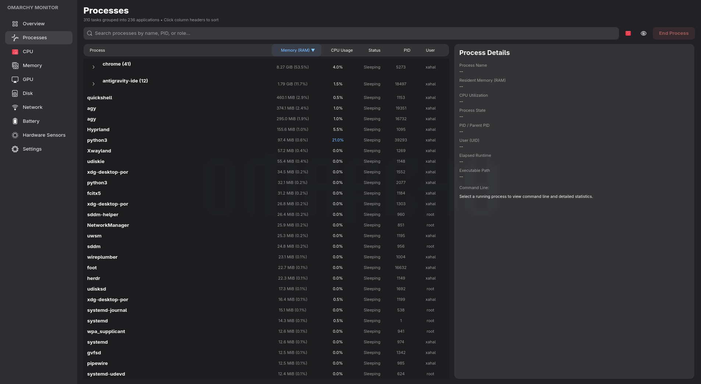

# Omarchy System Monitor



A lightweight, modern system monitor and Quickshell top-bar widget for **Omarchy Linux**. Features real-time CPU, RAM, GPU, Disk, Network, Battery, Hardware Sensors telemetry, and a process manager with application tree grouping.

---

### ⚡ Quick Install

Run this single command in your terminal to install and enable the top-panel widget:

```bash
omarchy plugin add https://github.com/sahal9229/Omarchy_system_monitor --enable
```

#### Manual Installation (from source):
```bash
git clone https://github.com/sahal9229/Omarchy_system_monitor.git
cd Omarchy_system_monitor
./install.sh
```

---

### 🚀 How to Launch
* **Top Bar**: Click the fan icon (`󰈐`) in the Omarchy top panel.
* **Shortcut**: Press `Ctrl + Shift + Esc`.
* **App Launcher**: Press `Super + Space`, type `System Monitor`, and press Enter.
* **Terminal**: Run `omarchy-sysmon`.

---

### 🌟 Key Features
* **Overview Dashboard**: Real-time summary cards with sparkline graphs for CPU, RAM, GPU, Disk, Network, Battery, and Thermals.
* **Process Manager**:
  * Windows Task Manager-style process tree grouping (groups sub-tasks/tabs under application roots).
  * Clickable column headers for instant CPU and RAM sorting.
  * Search filtering by process name, PID, or role.
  * Safe confirmation-based process termination (`SIGTERM` / `SIGKILL`).
* **Hardware Sensors (Strictly Read-Only)**: Real-time CPU core temperatures, SSD temperature, and cooling fan RPM. Never modifies BIOS or PWM controls.
* **High Efficiency**: Asynchronous background worker thread, sub-millisecond parsing, and row recycling for minimal CPU and memory usage.

---

### 🗑️ Uninstallation

```bash
omarchy plugin remove sahal.sysmon
```
Or run `./uninstall.sh` from the repository directory.

---

### 📄 License
MIT License. Copyright (c) 2026 sahal.
